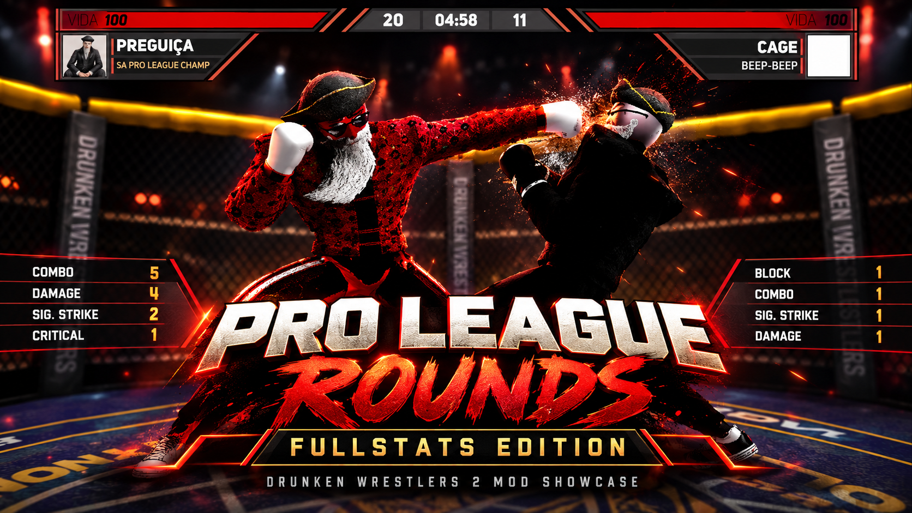

# Pro League Rounds — FullStats Edition

A published *Drunken Wrestlers 2* mod edition that brings a per-round HUD timer, detailed match statistics, and coordinated round, scoring, pause, and tie-break flows. This repository documents the engineering work and its evidence. It does **not** contain the mod's code or game files.

[View the published Steam Workshop item](https://steamcommunity.com/sharedfiles/filedetails/?id=3821094797) · [Read the technical case study](docs/CASE_STUDY.md) · [View the technology notes](docs/TECH_STACK.md)

## Project overview

The project builds on **Nixagorn's original Pro League Rounds**. The Workshop credits Nixagorn for the original pause fix and tie-break improvements. **PREGUIÇA** published the FullStats edition, including the custom HUD timer, expanded statistics, visual adjustments, and integration work. **Codex assisted** with analysis, code generation or adaptation, debugging, and documentation. The work is not presented as a solo implementation or as entirely hand-written code.

“Official Fullstats Edition” is part of the [Workshop item's title](https://steamcommunity.com/sharedfiles/filedetails/?id=3821094797); it does not imply endorsement by the game developer or by Nixagorn.

## Key features

| Area | Published behavior described on the Workshop item |
| --- | --- |
| Match formats | Unranked: three 3-minute rounds; Ranked: three 5-minute rounds; Title Fight: five 5-minute rounds. |
| Timer and HUD | A dedicated MM:SS countdown for each round, integrated into the in-game HUD. |
| Statistics | Round results, scores, and bonuses displayed during the 30-second break. |
| Pause and scoring | The round timer pauses; knockdown scoring is blocked during pauses and breaks. |
| Tie-break | Round wins take priority, then total points. If still tied, the host can start a 1-minute extra round or declare a draw. |

## Technologies

**C#**, **Unity UI**, **DynamicCSharp/Battlehub**, the game's RPC interface, the **Steam Workshop**, and functional testing in the game's Mod Editor and runtime. [Technology and architecture notes](docs/TECH_STACK.md) explain what each component does and what was actually verified.

## Technical challenges

The game has a native room timer, while the mod needs a separate timer for each round. Scoring, the HUD, breaks, and results must respond to the same match state. In a FullStats experiment, the complete results panel disappeared before the break ended: the break transition disabled the original text elements, and a later routine cleared them. The investigation also had to distinguish external C# compilation from DynamicCSharp compilation and behavior in the game.

## Solutions and implementation

The timer, round manager, scoring component, HUD component, and results component work together through match state and RPC updates. The FullStats experiment captured scores and bonuses **before** player data was reset, synchronized that snapshot, and controlled the original results text throughout the break. Scoring checks pause and break state before accepting events. The [case study](docs/CASE_STUDY.md) explains the sequence, the tie-break integration, and the limits of each observation.

## Testing and validation

The local record includes script inspection, comparison with code embedded in the scene, external compilation against installed game DLLs, Battlehub log analysis, and functional testing. Historical logs reported `compiled OK` for identified components, but those messages alone do not prove the final release's UI or online synchronization.

The project owner reported that the latest published version worked in their tests. This repository does not contain that session's logs or test matrix, so it makes no claims about test coverage, performance, downloads, or user adoption.

## Demonstration

**[Watch the 60-second gameplay demo (MP4, approx. 27 MB)](media/pro-league/video/pro-league-fullstats-demo-60s.mp4)**

This short showcase is edited from **real Drunken Wrestlers 2 gameplay** of the published FullStats edition. It highlights the Unranked and Title Fight modes, the custom per-round HUD timer, FullStats panels, round breaks, pause/resume, and transitions between rounds. The edited sequences are not a single uninterrupted match or evidence of frame-perfect network synchronization. Ranked and tie-break scenarios are **not shown** in this video.

The music is an original instrumental track created for the demo. The cover image is **stylized promotional artwork inspired by the recorded gameplay**, not a raw gameplay screenshot. Credits: the original Pro League Rounds mod, Pause Fix, and Tie Break are by **Nixagorn**; FullStats edition integration and testing by **PREGUIÇA**, with Codex/AI-assisted implementation. This project is not an official endorsement from the original author or the game's developer.

The [60-second capture plan](docs/DEMO_SCRIPT.md) records the intended shot list, including scenarios not shown in this edit. The [media directories](media/pro-league/README.md) explain how to add further authorized material with recorded credits.

## Credits and acknowledgments

- **Nixagorn:** original Pro League Rounds mod; original pause fix and tie-break improvements, as credited on the Workshop item.
- **PREGUIÇA:** published FullStats edition, custom HUD timer, expanded statistics, visual adjustments, and integration work, as described on the Workshop item.
- **Codex:** AI assistance with analysis, generated or adapted code, debugging, and documentation. This credit does not replace human review or testing.

No original third-party scripts, scenes, game binaries, or proprietary assets are distributed here. No license to third-party code or media is granted by this repository.
